# Tekt and pinned vanilla: pipeline comparison graph

This is a logical source map, not a time-scaled diagram or a new measurement. Source
fingerprints and exact dirty-tree state are recorded in pipeline-comparison-graph/.
Reference vanilla is pin 9f2b6e8715237cb086899a42873660fe744622e8. Source evidence is
compared with the preserved acquisition, metric, mechanics and retention studies.
No production, L0, ADR or benchmark change was made.

```mermaid
flowchart TB
  subgraph T[Current Tekt paginated PDF path]
    TW[World and fresh Source state] --> TE[Eval to Content]
    TE --> TL[Context stabilization and layout with text metrics]
    TL --> TS[Bidi and final document shaping]
    TS --> TP[Complete PDF export: subset, resources, builder, serialization]
    TP --> TI[Output I/O and publication]
    TF[Lazy catalog and FontSlots: World lifetime]
    TE -. font demand .-> TF
    TL -. font demand, including nontext Place .-> TF
    TS -. font demand .-> TF
    TL -. conditional stabilization .-> TL
    TI -->|watch: compile path builds another World| TW
  end
  subgraph V[Pinned vanilla paginated PDF path]
    VW[World and Source state] --> VE[Memoized eval to Content]
    VE --> VL[Layout with shaping and introspection constraints]
    VL --> VD[Document with positioned glyphs]
    VD --> VP[Complete PDF export: font adapter and krilla]
    VP --> VI[Output I/O and publication]
    VF[Lazy FontStore and OnceLock slots]
    VE -. font demand .-> VF
    VL -. font demand .-> VF
    VL -. conditional relayout .-> VL
    VI -->|watch: same World, reset files/time, preserve fonts| VW
  end
```

The font branches are nested demand, not extra phases to add to totals. Both engines
can discover fonts in evaluation when an explicit font declaration demands them.
The vanilla watch path additionally scans fonts before its displayed paginated
compile timer; the complete first-session cost still includes that work. A fresh
CLI process creates a new World in both implementations. Tekt's layout/shaping split
does not establish duplicated work: measure actual run identities/calls first.

| Difference | Evidence status | Test that can attribute cost |
|---|---|---|
| World/font lifetime across watch cycles | Source verified; lab intervention shows every paired session improved, but 16/27 timing groups unstable | Actual watch, identical changing-source sequence and font configuration; preserve invalidation/output, include first discovery |
| Nontext Place requests font metrics | Observed book calls, upstream controls without discovery, active RED tests | Independent font-demand intervention preserving geometry and image clipping |
| Metrics caches across helpers/passes | New instances found in paged pipeline; warm/fresh public-query microbench benefit demonstrated | Count instance creation, query keys/hits/misses per equivalent compilation |
| Width measurement plus final shaping | Two code paths exist; repeated work per identical run remains a hypothesis | Count shaping calls by text/face/axes/language/features; attribute misses on same fixture |
| Font instance/ShapePlan retention | Memoized upstream functions; Tekt miss creates Face and calls shape | Lab control with identical glyph output and retained face/plan, texts that vary |
| Coverage construction | Tekt collects points then compacts; upstream cmap builder emits/merges ordered runs | One controlled streaming construction change, exact coverage and matching catalog/output |
| TTC handling | Tekt reconstructs selected sfnt; upstream retains original bytes and face index | Same collection/face versus prepared sfnt with consumer compatibility validated |
| Stabilization loops | Both implementations iterate; Tekt has multiple conditional paths | Count passes and content consumed, rather than treating loop bound as execution count |
| PDF export | Both are composed operations; render_ms excludes subset in Tekt | Complete matched export interval, then disjoint nested subphases; never attribute all export to stream |
| I/O and timing boundaries | CLI, watch display and lab session have different boundaries | Simultaneous external/internal timers, equal options/cache/output policy |

Source anchors:

- Tekt World recreation: 04_wiring/src/watch.rs:63 and compile.rs:246.
- Tekt paginated composition: 03_infra/src/pipeline/paged.rs:188; conditional legacy
  relayout at :330; bidi/shaping at :469/:471. Context session creates metrics at
  context_stabilization.rs:135 and can attempt stabilization at :439. Individual
  helpers also create metrics; these are scope findings, not measured miss rates.
- Nontext subframe demand: 01_core/src/compiler/layout/sub_frame.rs:139.
- Tekt shaped measurement: 03_infra/src/font_metrics/fallback.rs:168. Final document
  caches: shaper/traversal.rs:17; miss face creation: shaper/shaping.rs:234.
- Tekt coverage: 03_infra/src/fonts.rs:404; Coverage: entities/font_book.rs:163.
- Complete export and partial timer: 03_infra/src/pipeline/pdf.rs:463 and :543.
- Vanilla World store/reset: typst-cli/src/world.rs:31/:113; watch pre-scan/reset:
  typst-cli/src/watch.rs:57/:77; compile/export selection: compile.rs:344.
- Vanilla eval/relayout: typst/src/lib.rs:124/:141; memoized eval:
  typst-eval/src/lib.rs:38. Instance memoization: typst-library/src/text/font/mod.rs:108;
  shaping with plan and memoized plan: typst-layout/src/inline/shaping.rs:1026/:1218.
  These upstream paths are relative to lab/typst-original/crates/.

Existing quantitative evidence is not recombined: the session retention experiment
and per-query microbenchmarks have different intervals, fixtures and cache policies.
The latest retention experiment's observed reductions support the lifetime mechanism
for recompilations, not the entire cold Tekt–vanilla gap. Its output controls match
current Tekt, not global vanilla parity. Known Place output regressions remain open.

The most useful next attribution is to record, for one equivalent fixture, a call
graph with invocation counts, metric/cache identity, hits/misses, stabilization passes,
and inclusive/exclusive durations. Separate cold first compile from changing-source
recompilation. The current map prioritizes those observations; it is not a profiler
trace and does not assign invented percentages to unmeasured nodes.
